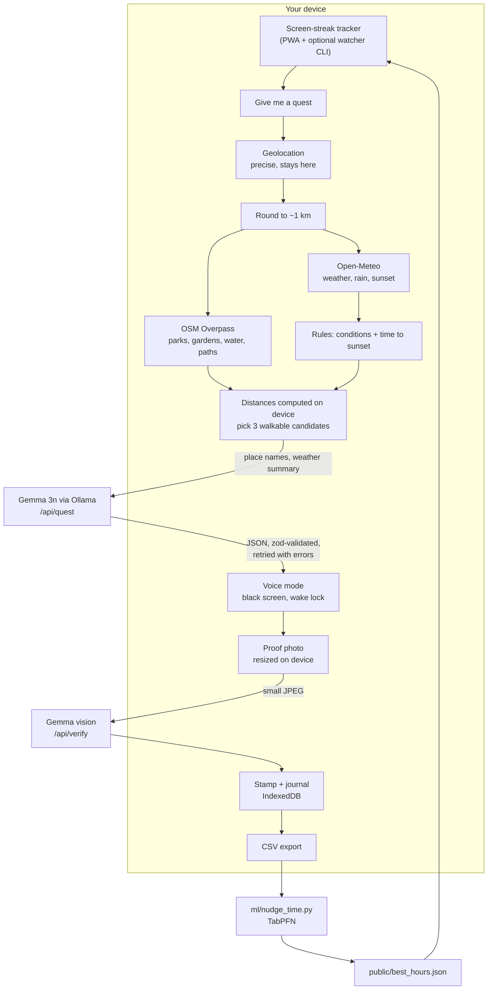

<p align="center">
  
</p>

<h1 align="center">Side Quest</h1>

<p align="center"><b>You've been on a screen for 90 minutes. Here's a 20-minute quest outside, picked for your weather, your sunset and the nearest patch of green. Then the screen goes dark.</b></p>

<p align="center">
A local-first Gemma agent. Screen time and GPS never leave your device. Works offline on the trail. Costs ₹0 to run.
</p>

---

## What it does

1. **Notices.** Side Quest tracks continuous screen time: inside the PWA, and optionally across your whole computer with a tiny desktop watcher.
2. **Plans.** When you ask (or get nudged), it checks the weather, rain chance and minutes to sunset ([Open-Meteo](https://open-meteo.com)), finds parks, gardens, water and footpaths within walking distance ([OpenStreetMap Overpass](https://wiki.openstreetmap.org/wiki/Overpass_API)), and lets simple safety rules decide what kind of quest is allowed right now.
3. **Writes.** Gemma (`gemma3n:e4b` on Ollama by default) picks one place and writes a quest: three short steps you can do with your senses ("find three different red leaves"), a safety line, and one thing to photograph as proof.
4. **Goes dark.** Tap *Go dark* and the screen turns black. The quest continues by voice, one step per tap anywhere on the screen. A wake lock keeps it running.
5. **Checks.** Take one photo. A vision-capable Gemma looks at a small copy and says, warmly, whether it shows what the quest asked for. You get a stamp.
6. **Remembers, locally.** Quests, photos and stats live in your browser's IndexedDB. Export a CSV and a small TabPFN script learns which hours you actually say yes, so nudges come at the right time.

If it's raining, dark, dangerously hot or stormy, the quest becomes **indoor-adjacent** (balcony, terrace, stairwell window) and is clearly labelled as such. The model is told the verdict; it doesn't get to overrule it.

## Screenshots

> Placeholders. Replace with real captures from your phone.

| Home | Quest | Voice mode | Stamp | Journal |
| --- | --- | --- | --- | --- |
| `docs/screenshots/home.png` | `docs/screenshots/quest.png` | `docs/screenshots/voice.png` | `docs/screenshots/stamp.png` | `docs/screenshots/journal.png` |

## Why open

This only works because the model is open and runs where you are.

- **Privacy that isn't a policy.** The two most personal signals here, how long you stare at screens and where you are, never touch a third-party AI API. Your precise location stays in the browser; weather and park lookups receive a point rounded to about 1 km; the model receives place names and a weather summary, never coordinates.
- **Works with no signal.** Quests are written before you leave. The service worker caches the app shell and the active quest lives in local storage, so voice mode keeps working on a trail with zero bars.
- **Free to run.** Ollama + Gemma on your own laptop costs nothing per quest. No API key is required for anything in the core loop.
- **Swappable.** Point it at `gemma3n:e2b` on an old laptop, `gemma4:e4b` for better vision, a 12B on a GPU Droplet, or a fine-tune of your own. One env var.

## Quickstart

```bash
# 1. Models (once)
ollama pull gemma3n:e4b     # writes the quests
ollama pull gemma4:e4b      # checks the photos (Ollama's gemma3n build is text-only)

# 2. App
git clone https://github.com/Tusharkhadde/side-quest && cd side-quest
cp .env.example .env.local
npm install
npm run dev                 # http://localhost:3000
```

No GPU or Ollama yet? Run the whole flow with a deterministic mock model:

```bash
npm run demo                # DEMO_MODE=1
```

To use it on your phone, open the app over HTTPS (geolocation, camera and wake lock need a secure context), for example with `npx localtunnel --port 3000` or by deploying it, then *Add to Home Screen*.

## How it works



**The agent loop** (`lib/client/questFlow.ts`, `lib/agent/quest.ts`):

1. *Gather* on the device: location, weather, nearby green and blue space.
2. *Decide* in code: `classifyConditions()` returns `good | rain | dark | too-hot | too-cold | storm`. The quest must fit before sunset with a 10-minute buffer; the walk there may use at most 35% of the quest time.
3. *Generate* with Gemma: a strict JSON contract (`QuestDraftSchema`) plus a context-aware check that the place id is one of the candidates and that bad conditions produce an indoor-adjacent quest. On failure, the validation errors go back to the model for a repair attempt (up to 3 tries).
4. *Fall back* gracefully: if the model is unreachable, a hand-written quest for that kind of place is used and the UI says so.

**Photo verification** (`lib/agent/verify.ts`): the photo is resized to 768px on the device, sent to your model server with the proof criterion, and Gemma returns `{ pass, comment, confidence }`. The server route does not store it. If the model is offline, you can stamp it on your honour.

**Providers** (`lib/llm`): `OllamaProvider` (native `/api/chat`, `format: "json"`), `OpenAICompatibleProvider` (vLLM, llama.cpp, LM Studio, Ollama's `/v1`, DigitalOcean), and `MockProvider` (tests and demo mode).

### What leaves your device

| Data | Where it goes |
| --- | --- |
| Screen time | Nowhere. localStorage (PWA) and `~/.side-quest/watch.json` (watcher). |
| Precise location | Nowhere. Used in the browser to compute distances. |
| Location rounded to ~1 km | Open-Meteo and OpenStreetMap Overpass, for weather and nearby parks. |
| Place names, weather summary, quest length | Your model server (local Ollama by default). |
| Proof photo (resized) | Your model server, for one check. Stored only in your browser. |
| Journal, photos, stats | Nowhere. IndexedDB in your browser. "Delete all my data" in Settings wipes it. |

## Configuration

| Variable | Default | What it does |
| --- | --- | --- |
| `LLM_PROVIDER` | `ollama` | `ollama`, `openai` (any OpenAI-compatible server) or `mock` |
| `OLLAMA_URL` | `http://localhost:11434` | Ollama server |
| `OLLAMA_MODEL` | `gemma3n:e4b` | Model that writes quests |
| `OLLAMA_VISION_MODEL` | `gemma4:e4b` | Model that checks photos (must accept images) |
| `LLM_BASE_URL` | | OpenAI-compatible base URL, e.g. `http://<droplet>:8000/v1` |
| `LLM_API_KEY` | | Bearer token for that server, if it needs one |
| `LLM_MODEL` | `google/gemma-3n-E4B-it` | Model name on that server |
| `LLM_VISION_MODEL` | same as `LLM_MODEL` | Vision model on that server |
| `DEMO_MODE` | `0` | `1` runs the deterministic mock model |
| `ALLOW_MODEL_OVERRIDE` | `0` | Let the Settings page choose a model endpoint in production (always on in dev) |
| `ELEVENLABS_API_KEY` | | Optional. Enables the ElevenLabs voice in voice mode |
| `ELEVENLABS_VOICE_ID` | `21m00Tcm4TlvDq8ikWAM` | Optional. Voice to use |

In-app settings (quest length, nudge threshold, search radius, home area for when GPS is off, voice) are stored in the browser.

## Desktop watcher (optional)

The PWA can only see time spent inside its own tab. To notice long stretches anywhere on your computer, run the watcher. It has no dependencies, makes no network calls, and keeps its state in `~/.side-quest/watch.json`.

```bash
npx ./watcher                         # from the repo root
npx ./watcher --threshold 60 --url http://localhost:3000
node watcher/bin/side-quest-watch.js --once   # print idle seconds and exit
```

After `--threshold` minutes (default 90) of activity without a 5-minute break, it shows a desktop notification and opens `/quest?new=1&screen=<minutes>`. It stays quiet between 22:00 and 07:00 (`--quiet 22-7`) and waits 30 minutes between nudges.

How it reads idle time, honestly:

- **macOS:** `ioreg -c IOHIDSystem` (`HIDIdleTime`). Works out of the box.
- **Linux (X11):** `xprintidle`, which you need to install. Wayland sessions are not supported.
- **Windows:** PowerShell calling `GetLastInputInfo`. Notifications are a tray balloon.

It measures input activity, not what's on screen: watching a long video without touching anything counts as idle.

## Smart nudge timing (TabPFN)

Isolated in `ml/`, entirely optional.

```bash
python -m venv .venv && source .venv/bin/activate
pip install -r ml/requirements.txt
python ml/nudge_time.py --csv ml/sample_journal.csv --print
# or with your own export from Journal → "Export CSV"
python ml/nudge_time.py --csv ~/Downloads/side-quest-journal-YYYY-MM-DD.csv
```

The script trains [TabPFN](https://github.com/PriorLabs/TabPFN)'s `TabPFNClassifier` on hour, weekday, weather, temperature, minutes to sunset and conditions, predicts the chance you'd accept a quest at each hour, and writes `public/best_hours.json`. The app reads it to label your best hours and decide whether "now" is a good time. Without the file, a heuristic in `lib/nudge.ts` blends a daylight-shaped prior with your own accept rate per hour.

`ml/sample_journal.csv` is **synthetic** (generated by `ml/make_sample.py`) so you can try the script before you have real data. On first run TabPFN downloads its model weights; follow its prompts if it asks you to accept a licence.

## Deploy

### Docker Compose (app + Ollama on one machine)

```bash
docker compose up -d
docker compose exec ollama ollama pull gemma3n:e4b
docker compose exec ollama ollama pull gemma4:e4b
```

Uncomment the `deploy` block in `docker-compose.yml` to give Ollama an NVIDIA GPU.

### DigitalOcean (GPU Droplet for Gemma + App Platform for the app)

1. Create a GPU Droplet and install Ollama, listening on the private network:
   ```bash
   curl -fsSL https://ollama.com/install.sh | sh
   sudo systemctl edit ollama   # add: Environment="OLLAMA_HOST=0.0.0.0"
   sudo systemctl restart ollama
   ollama pull gemma3n:e4b && ollama pull gemma4:e4b
   ```
   Restrict port 11434 to your app with a DigitalOcean Cloud Firewall. (vLLM serving `google/gemma-3n-E4B-it` on `:8000/v1` works the same way.)
2. Edit `.do/app.yaml`, set `LLM_BASE_URL` to `http://<droplet-private-ip>:11434/v1`, then:
   ```bash
   doctl apps create --spec .do/app.yaml
   ```
   Any OpenAI-compatible Gemma endpoint, including DigitalOcean's Gradient platform, plugs into the same three variables: `LLM_BASE_URL`, `LLM_API_KEY`, `LLM_MODEL`.

Hosting the web app on a server means the rounded location and photo pass through that server on their way to the model. For the strongest privacy, run everything on your own machine.

### Render

`render.yaml` deploys the Docker image. Render has no GPUs, so set `LLM_BASE_URL` to a model server you run elsewhere, or set `DEMO_MODE=1` for a public demo.

## Develop

```bash
npm run lint
npm run typecheck
npm test                         # vitest: schemas, Overpass parsing, weather rules, nudge heuristic, mock agent loop
node --test watcher/lib.test.js  # watcher logic
npm run build
```

```
app/            pages (Home, Quest, Voice, Finish, Journal, Settings) and API routes
lib/agent/      prompts, quest agent loop, photo verification, built-in quest bank
lib/context/    Open-Meteo, Overpass, caching, safety rules
lib/llm/        Ollama, OpenAI-compatible and mock providers, JSON repair loop
lib/client/     IndexedDB, settings, location, camera resize, speech, wake lock
watcher/        zero-dependency desktop watcher
ml/             TabPFN nudge timing
public/sw.js    offline service worker
```

## Limitations

- **The PWA sees only itself.** Browsers can't read system-wide screen time; that's what the watcher is for, and the watcher sees input, not attention.
- **Photo checks need a vision model.** In Ollama today, `gemma3n` is text-only, so photo checks default to `gemma4:e4b`. Any vision-capable Gemma works.
- **Voice quality depends on your device.** The Web Speech API is free and often offline, but voices vary by OS. ElevenLabs is optional and sends the step text to ElevenLabs.
- **OpenStreetMap coverage varies.** Small neighbourhood parks may be unmapped or unnamed; when nothing is in range, the quest becomes a loop around the block.
- **Weather and parks need a connection once.** After a quest is written, it runs offline. Writing a new one needs Open-Meteo, Overpass and your model server to be reachable.
- **It's a nudge, not a guardian.** The safety rules are conservative defaults, not guarantees. Use your judgement about where and when you walk.

## License

MIT. See [LICENSE](LICENSE).
