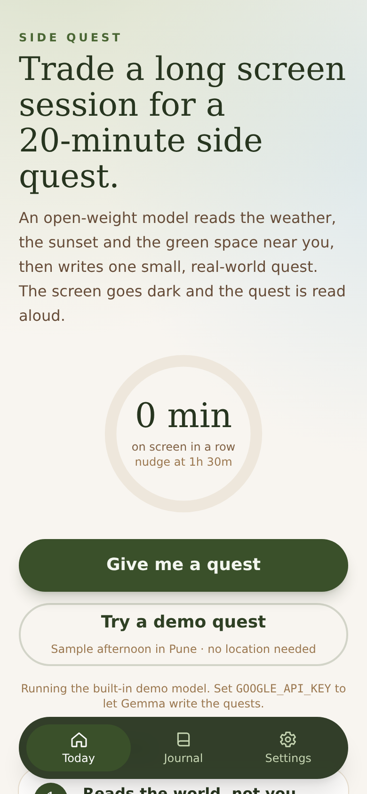
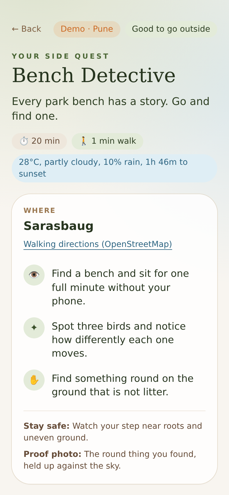
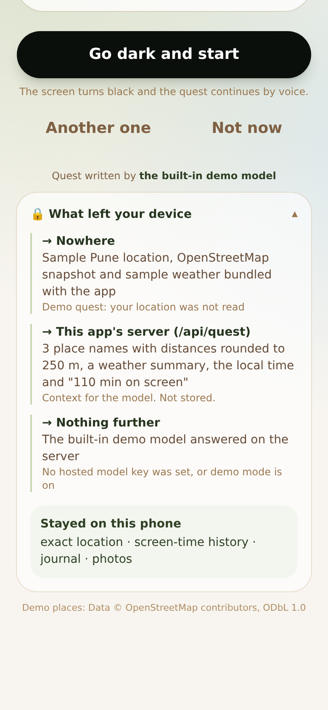
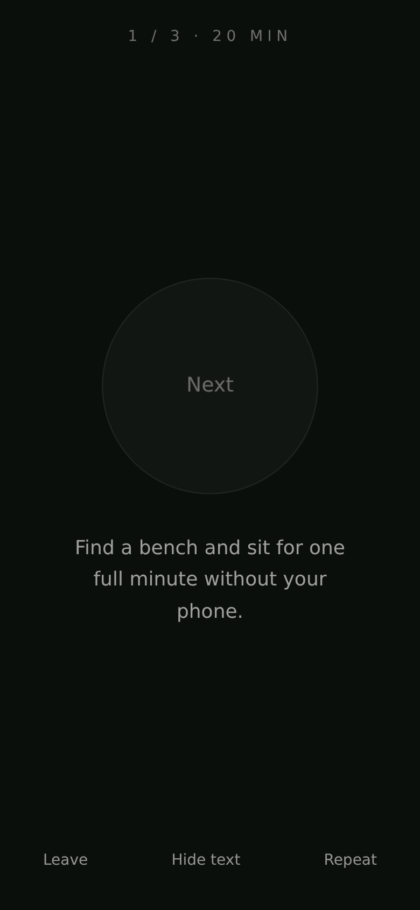
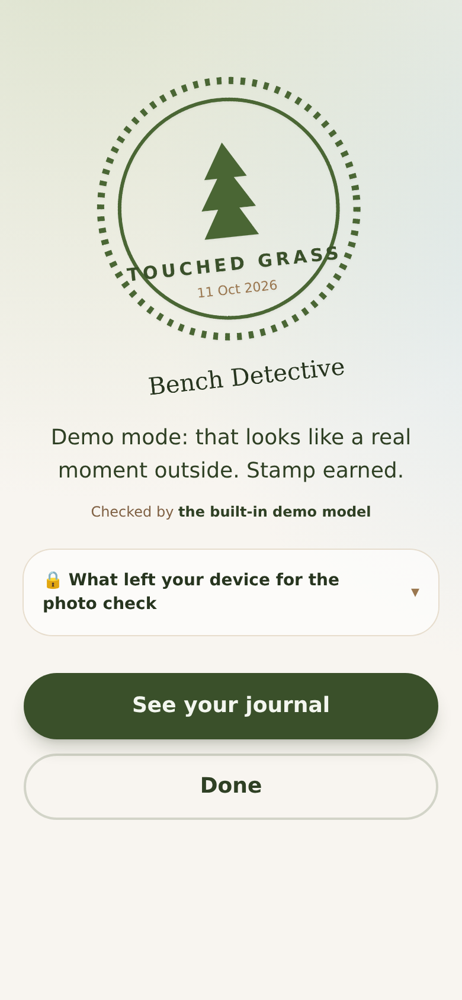
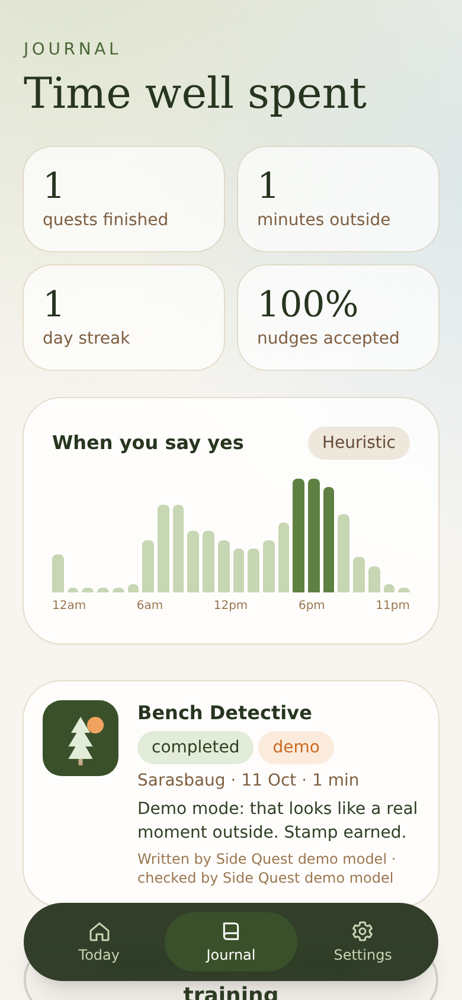
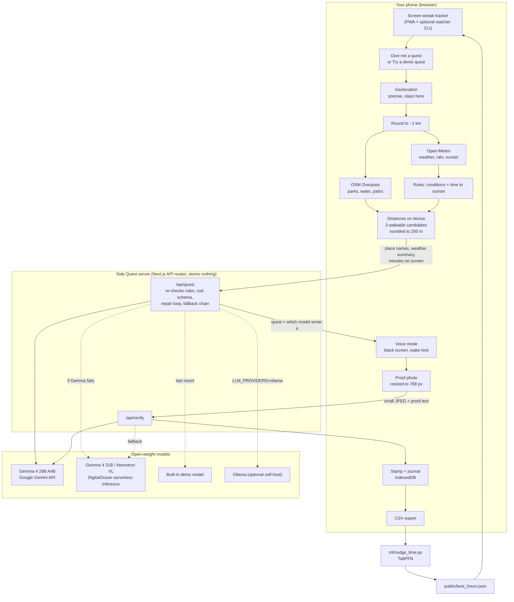

<p align="center">
  
</p>

<h1 align="center">Side Quest</h1>

<p align="center"><b>You've been on a screen for 90 minutes. Here's a 20-minute quest outside, picked for your weather, your sunset and the nearest patch of green. Then the screen goes dark.</b></p>

<p align="center">
An agent built on open-weight models. <b>Gemma</b> writes the quest and checks your proof photo; if it is unavailable, other open models on <b>DigitalOcean</b> take over. Your exact location, screen-time history and photos stay on your phone.
</p>

<p align="center">
  <a href="https://cloud.digitalocean.com/apps/new?repo=https://github.com/Tusharkhadde/side-quest/tree/main"></a>
</p>

---

| Home | Demo quest | What left your device | Voice mode | Stamp | Journal |
| --- | --- | --- | --- | --- | --- |
|  |  |  |  |  |  |

<sub>Captured at 390×844 with `scripts/screenshots.mjs` in demo mode (built-in demo model, sample Pune data), so the quest text comes from the hand-written bank, not Gemma. More in [`docs/screenshots/`](docs/screenshots).</sub>

## Quickstart (2 minutes, no GPU, no Ollama)

1. Get a free Gemini API key in Google AI Studio: <https://aistudio.google.com/apikey>. It serves Gemma, Google's open-weight model.
2. Run:

```bash
git clone https://github.com/Tusharkhadde/side-quest && cd side-quest
cp .env.example .env.local
# put your key in .env.local:  GOOGLE_API_KEY=...
npm install
npm run dev            # http://localhost:3000
```

3. Tap **Try a demo quest** (sample afternoon in Pune, no location permission needed) or **Give me a quest** (uses your location).

No key at all? The app still runs end to end with a built-in demo model (`npm run demo` forces it). The UI always says which model wrote the quest.

To use it on your phone, open it over HTTPS (geolocation, camera and wake lock need a secure context), for example by deploying it with the button above, then *Add to Home Screen*.

## What it does

1. **Notices.** Tracks continuous screen time inside the PWA, and optionally across your whole computer with a tiny desktop watcher.
2. **Plans.** Checks weather, rain chance and minutes to sunset ([Open-Meteo](https://open-meteo.com)) and finds parks, gardens, water and footpaths within walking distance ([OpenStreetMap Overpass](https://wiki.openstreetmap.org/wiki/Overpass_API)). Plain-code safety rules decide what kind of quest is allowed right now.
3. **Writes.** Gemma picks one place and writes a quest: three short steps you do with your senses ("find three different red leaves"), a safety line, and one thing to photograph as proof. The screen shows which open model wrote it.
4. **Goes dark.** The screen turns black and the quest continues by voice, one step per tap anywhere. A wake lock keeps it running.
5. **Checks.** One photo, shrunk on the phone, is checked by an open vision model (Gemma 4 by default). You get a stamp.
6. **Remembers, locally.** Quests, photos and stats live in IndexedDB. Export a CSV and a small TabPFN script learns which hours you actually say yes.

If it's raining, dark, dangerously hot or stormy, the quest becomes **indoor-adjacent** (balcony, terrace, stairwell window) and is labelled that way. The model is told the verdict; it can't overrule it.

## The models

| Role | Default | Where it runs | Why |
| --- | --- | --- | --- |
| Quest writing | **Gemma 4 26B A4B** (`gemma-4-26b-a4b-it`) | Google Gemini API | Open weights, multimodal, fast mixture-of-experts, free tier in AI Studio |
| Photo check | **Gemma 4 26B A4B** (same model, image input) | Google Gemini API | One open model for both jobs |
| Fallback: text | **Gemma 4 31B** (`gemma-4-31B-it`) | DigitalOcean serverless inference | Same open family, hosted on DigitalOcean's own GPUs |
| Fallback: photos | **Nemotron Nano 12B v2 VL** (`nemotron-nano-12b-v2-vl`) | DigitalOcean serverless inference | Open-weight vision-language model |
| Last resort | Built-in demo model | This server | Deterministic, no network, so the app never dead-ends |
| Self-host (optional) | `gemma3n:e4b` / `gemma4:e4b` | Ollama on your machine or GPU Droplet | Same open weights, nothing leaves your hardware |

Model ids were checked against Google's [Gemma on the Gemini API](https://ai.google.dev/gemma/docs/core/gemma_on_gemini_api) page (which now lists Gemma 4: `gemma-4-31b-it`, `gemma-4-26b-a4b-it`) and DigitalOcean's [supported models](https://docs.digitalocean.com/products/inference/details/models/) list. Every id is an env var, so when a newer Gemma ships it's a one-line change.

**Fallback chain.** `LLM_PROVIDERS=gemma-google,do-gradient,demo` (the default) tries each in order. A provider is skipped if its key isn't set, and abandoned if it errors, times out (`LLM_TIMEOUT_MS`, default 25 s) or still returns invalid JSON after the repair loop. Photo checks skip providers without a vision model. Every hop is recorded and shown in the app.

**Gemma on the Gemini API, specifically** (`lib/llm/google.ts`): requests go to `POST https://generativelanguage.googleapis.com/v1beta/models/{model}:generateContent` with the key in the `x-goog-api-key` header (never in the URL, never in the browser). The system prompt goes in `systemInstruction`, photos go as `inlineData` JPEG parts after the text, and `generationConfig` asks for `responseMimeType: application/json` with `thinkingLevel: minimal` to keep latency down. If the API rejects any of that with a 400 (older Gemma builds did not accept system instructions or JSON mode), the provider switches to a plain request with the system prompt folded into the user turn and remembers it. Either way the reply is parsed with a forgiving JSON extractor (fences, chatter, trailing commas, smart quotes), validated with zod, and on failure the validation errors are sent back for a repair attempt.

## Why open weights, even when hosted

Hosting Gemma on someone else's GPU is still different from calling a closed model:

- **No lock-in.** The exact same weights are on Hugging Face and Kaggle. If the Gemini API changes its terms, the app moves to DigitalOcean, OpenRouter, a GPU Droplet or a laptop by changing `LLM_PROVIDERS`. Nothing in the prompts or schemas is vendor-specific.
- **Self-hosting is one env var.** `LLM_PROVIDERS=ollama` (or an OpenAI-compatible URL with `LLM_PROVIDERS=openai`) and photos never leave your hardware.
- **It can be fine-tuned.** The journal already records which quests people finish. That's a dataset for a LoRA on the same Gemma, served by the same code.
- **Transparent.** Gemma has a public model card, licence and prohibited-use policy. You can read what you are running.
- **Cheap.** Gemma on the Gemini API free tier costs nothing per call (see [pricing](https://ai.google.dev/gemini-api/docs/pricing)); DigitalOcean serverless inference is pay-per-token with no GPU to keep warm.

## Privacy, honestly

Hosted models mean some data does leave the phone. Here is exactly what, and the app shows the same list per quest in a **"What left your device"** panel.

| Data | Where it goes |
| --- | --- |
| Precise GPS | Nowhere. Used in the browser to compute distances. |
| Location rounded to ~1 km (2 decimals) | Open-Meteo and OpenStreetMap Overpass, for weather and parks. Never to the model or this server. |
| Candidate places | This server, then the model: place names and types, with distances rounded to 250 m and walk times to 5 min, so three distances can't be used to trilaterate you. The home/block candidate carries only the rounded point. |
| Screen time | Only "N minutes on screen" goes to the server for the prompt. The history stays in localStorage and `~/.side-quest/watch.json`. |
| Proof photo | A 768 px JPEG copy, only when you tap *Check my photo*. Passed straight to the vision model; this server never writes it to disk or logs it. The original stays in your browser. |
| Journal, photos, stats | Nowhere. IndexedDB in your browser. *Delete all my data* in Settings wipes it. |
| API keys | Server env vars only. The browser can only *reorder* the providers the server already has. |

Provider terms matter too: on the Gemini API **free tier**, Google says inputs may be used to improve its products ([pricing page](https://ai.google.dev/gemini-api/docs/pricing), "Used to improve our products: Yes"). DigitalOcean says it does not store inference inputs or outputs and does not train on them ([data privacy](https://docs.digitalocean.com/products/inference/details/data-privacy/)). If that difference matters to you, send photos to DigitalOcean with `VISION_PROVIDERS=do-gradient`, or self-host.

## How it works



**The agent loop** (`lib/client/questFlow.ts`, `lib/agent/quest.ts`, `lib/llm/chain.ts`):

1. *Gather* on the device: location, weather, nearby green and blue space.
2. *Decide* in code: `classifyConditions()` returns `good | rain | dark | too-hot | too-cold | storm`. The quest must fit before sunset with a 10-minute buffer; the walk there may use at most 35% of the quest.
3. *Generate* with the open-model chain: a strict JSON contract (`QuestDraftSchema`) plus checks that the place id is a real candidate and that bad conditions produce an indoor-adjacent quest. Validation errors go back to the model (up to 3 tries); then the next provider is tried.
4. *Fall back* gracefully: if every model fails, a hand-written quest for that kind of place is used and the UI says so.

## Configuration

| Variable | Default | What it does | Where to get it |
| --- | --- | --- | --- |
| `GOOGLE_API_KEY` | | Gemma on the Gemini API (`GEMINI_API_KEY` also works; `GOOGLE_API_KEY` wins if both are set) | [Google AI Studio → API keys](https://aistudio.google.com/apikey) |
| `GEMMA_MODEL` | `gemma-4-26b-a4b-it` | Gemma model for quests (`gemma-4-31b-it` is the larger dense one) | |
| `GEMMA_VISION_MODEL` | same as `GEMMA_MODEL` | Gemma model for photo checks; `none` disables vision on this provider | |
| `DO_MODEL_ACCESS_KEY` | | DigitalOcean serverless inference (`MODEL_ACCESS_KEY` also works) | [DigitalOcean → Model access keys](https://cloud.digitalocean.com/model-studio/manage-keys) ([docs](https://docs.digitalocean.com/products/inference/how-to/manage-model-access-keys/)) |
| `DO_MODEL` | `gemma-4-31B-it` | Text model on DigitalOcean | [model list](https://docs.digitalocean.com/products/inference/details/models/) |
| `DO_VISION_MODEL` | `nemotron-nano-12b-v2-vl` | Vision model on DigitalOcean; `none` disables | |
| `DO_INFERENCE_URL` | `https://inference.do-ai.run/v1` | DigitalOcean's OpenAI-compatible endpoint | |
| `LLM_PROVIDERS` | `gemma-google,do-gradient,demo` | Fallback order. Ids: `gemma-google`, `do-gradient`, `openai`, `ollama`, `demo` | |
| `VISION_PROVIDERS` | same as `LLM_PROVIDERS` | Separate order for photo checks, e.g. `do-gradient` | |
| `LLM_BASE_URL`, `LLM_API_KEY`, `LLM_MODEL`, `LLM_VISION_MODEL` | | Any OpenAI-compatible server (OpenRouter, Groq, Hugging Face, vLLM on a GPU Droplet). Add `openai` to `LLM_PROVIDERS`. | |
| `OLLAMA_URL`, `OLLAMA_MODEL`, `OLLAMA_VISION_MODEL` | `http://localhost:11434`, `gemma3n:e4b`, `gemma4:e4b` | Self-host path. Add `ollama` to `LLM_PROVIDERS`. | [ollama.com](https://ollama.com) |
| `LLM_TIMEOUT_MS` / `VISION_TIMEOUT_MS` | `25000` / `45000` | Time budget per provider before falling through | |
| `DEMO_MODE` | `0` | `1` = only the built-in demo model, no network | |
| `ELEVENLABS_API_KEY`, `ELEVENLABS_VOICE_ID` | | Optional ElevenLabs voice for voice mode | |

In-app settings (quest length, nudge threshold, search radius, home area for when GPS is off, voice, which configured model to try first) are stored in the browser.

## Deploy

### DigitalOcean App Platform (recommended)

Click **Deploy to DigitalOcean** at the top. App Platform reads `.do/deploy.template.yaml`, builds the Dockerfile and asks for `GOOGLE_API_KEY` (and optionally `DO_MODEL_ACCESS_KEY`) as encrypted secrets. Or from the CLI:

```bash
doctl apps create --spec .do/app.yaml
# then set GOOGLE_API_KEY / DO_MODEL_ACCESS_KEY in the app's Settings → Environment Variables (encrypted)
```

No GPU or Droplet is needed: the models are hosted. The smallest instance (`apps-s-1vcpu-1gb`) is enough.

### Render

`render.yaml` deploys the same Docker image; set `GOOGLE_API_KEY` (and optionally `DO_MODEL_ACCESS_KEY`) in the dashboard.

### Docker

```bash
GOOGLE_API_KEY=... docker compose up -d                          # hosted open models
LLM_PROVIDERS=ollama docker compose --profile ollama up -d         # optional: self-host with Ollama
docker compose exec ollama ollama pull gemma3n:e4b && docker compose exec ollama ollama pull gemma4:e4b
```

Hosting the web app means the rounded data and the photo pass through your server on their way to the model. The server keeps none of it, and for the strongest privacy you can run everything on your own machine.

## Desktop watcher (optional)

The PWA can only see time spent inside its own tab. To notice long stretches anywhere on your computer, run the watcher. It has no dependencies, makes no network calls, and keeps its state in `~/.side-quest/watch.json`.

```bash
npx ./watcher                         # from the repo root
npx ./watcher --threshold 60 --url http://localhost:3000
node watcher/bin/side-quest-watch.js --once   # print idle seconds and exit
```

After `--threshold` minutes (default 90) of activity without a 5-minute break, it shows a desktop notification and opens `/quest?new=1&screen=<minutes>`. It stays quiet between 22:00 and 07:00 (`--quiet 22-7`) and waits 30 minutes between nudges.

How it reads idle time: macOS `ioreg -c IOHIDSystem` (works out of the box); Linux X11 `xprintidle` (install it; Wayland is not supported); Windows PowerShell calling `GetLastInputInfo`. It measures input activity, not attention: watching a long video without touching anything counts as idle.

## Smart nudge timing (TabPFN)

Isolated in `ml/`, entirely optional.

```bash
python -m venv .venv && source .venv/bin/activate
pip install -r ml/requirements.txt
python ml/nudge_time.py --csv ml/sample_journal.csv --print
python ml/nudge_time.py --csv ~/Downloads/side-quest-journal-YYYY-MM-DD.csv   # your own export
```

The script trains [TabPFN](https://github.com/PriorLabs/TabPFN)'s `TabPFNClassifier` on hour, weekday, weather, temperature, minutes to sunset and conditions, predicts the chance you'd accept a quest at each hour, and writes `public/best_hours.json`. Without the file, a heuristic in `lib/nudge.ts` is used. `ml/sample_journal.csv` is **synthetic** so you can try the script before you have real data.

## Develop

```bash
npm run lint
npm run typecheck
npm test                         # vitest: providers (fake fetch), fallback chain, JSON repair, schemas, Overpass, weather, privacy blur, demo data
node --test watcher/lib.test.js  # watcher logic
npm run build
# screenshots (needs a Chromium for Playwright):
DEMO_MODE=1 npm run build && DEMO_MODE=1 npx next start -p 3100 &
BASE_URL=http://localhost:3100 node scripts/screenshots.mjs
```

```
app/            pages (Home, Quest, Voice, Finish, Journal, Settings) and API routes
lib/llm/        Gemma (Gemini API), OpenAI-compatible (DigitalOcean etc.), Ollama and demo providers, fallback chain, JSON repair
lib/agent/      prompts, quest agent loop, photo verification, built-in quest bank
lib/context/    Open-Meteo, Overpass, caching, safety rules
lib/demo/       sample Pune point, OpenStreetMap snapshot, sample weather
lib/client/     IndexedDB, settings, location, disclosure, camera resize, speech, wake lock
watcher/        zero-dependency desktop watcher
ml/             TabPFN nudge timing
public/sw.js    offline service worker
```

## Limitations

- **Hosted means online.** Writing a quest or checking a photo needs the server and a model provider to be reachable. A written quest then runs offline (voice mode, service worker). Self-host if you need fully offline model calls.
- **Free tiers have limits.** The Gemini API free tier is rate-limited; when Gemma is busy the chain falls through to DigitalOcean (paid per token) or the demo model, and the UI shows which one answered.
- **Free-tier data terms.** See the privacy section: Google may use free-tier inputs to improve its products.
- **Model ids move.** Gemma 3 is no longer listed for the Gemini API; defaults are Gemma 4. All ids are env vars.
- **The demo quest uses sample data.** A bundled OpenStreetMap snapshot around Sarasbaug, Pune, and a sample afternoon forecast, clearly labelled. The model call is real if a key is set.
- **The PWA sees only itself.** Browsers can't read system-wide screen time; that's what the watcher is for, and the watcher sees input, not attention.
- **Voice quality depends on your device.** Web Speech voices vary by OS. ElevenLabs is optional and sends the step text to ElevenLabs.
- **OpenStreetMap coverage varies.** Small parks may be unmapped; when nothing is in range, the quest becomes a loop around the block.
- **It's a nudge, not a guardian.** The safety rules are conservative defaults, not guarantees. Use your judgement about where and when you walk.

## License

MIT. See [LICENSE](LICENSE). Demo place data © OpenStreetMap contributors, ODbL 1.0.
